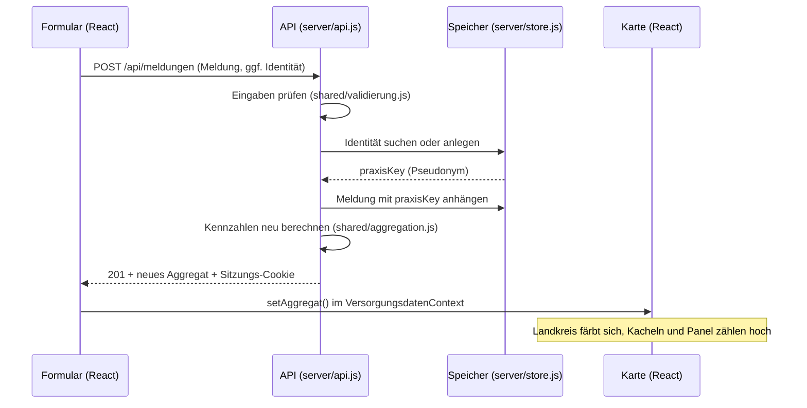
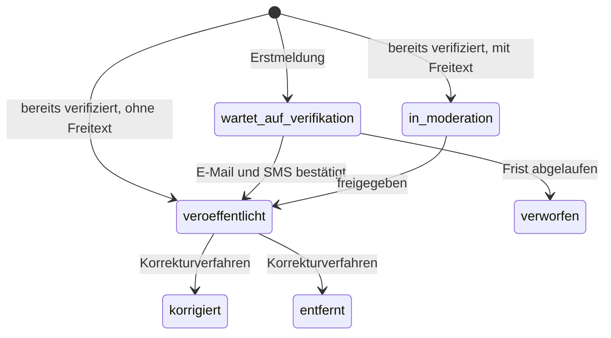

# Konzept: Wie neue Meldungen gespeichert werden

Stand: 05.11.2026

## Kurzfassung

Eine abgeschickte Meldung landet als neuer Datensatz auf dem Server. Der Server berechnet daraus sofort die Kennzahlen neu und schickt sie in derselben Antwort zurück. Die React-App tauscht damit ihren Datenstand aus, und Karte, Kacheln und Seitenpanel zeigen die Meldung ohne Neuladen.

Drei Regeln tragen das Konzept:

1. **Identität und Meldung liegen getrennt.** Name, LANR und E-Mail stehen nie in einer Meldung. Beide Seiten verbindet nur ein zufälliger Schlüssel.
2. **Der Browser bekommt nur Summen.** Einzelmeldungen verlassen den Server nicht. So setzt die Technik die Zusage „ausschließlich aggregiert“ aus dem Abschnitt Persönlichkeitsrechte um.
3. **Meldungen werden nur ergänzt, nie überschrieben.** Der Stand einer Praxis wird aus all ihren Meldungen berechnet, weil die Referenzregel das verlangt (vorher aus der ersten, jetzt aus der neuesten Meldung).

## Datenfluss



Der Link „Auswirkung auf der Karte ansehen“ führt auf `/?landkreis=<id>`. Die Kartenseite wählt den Landkreis aus dieser URL aus.

## Was wo liegt

| Datei | Inhalt | Git | Öffentlich? |
| --- | --- | --- | --- |
| `data/demo/meldungen.demo.json` | die 16 Demo-Meldungen aus dem Prototyp | ja | nein, nur als Summe |
| `data/neu/meldungen.jsonl` | neue Meldungen, eine JSON-Zeile je Meldung | nein | nein, nur als Summe |
| `data/neu/identitaeten.json` | Identitäten und Pseudonym-Schlüssel | nein | nie |
| `data/stammdaten/*.json` | Landkreise, Formularoptionen | ja | ja |

`data/neu/` entsteht erst beim ersten Absenden. Neu angelegte Meldungen überleben Neuladen und Serverneustart. Zum Zurücksetzen löscht man die beiden Dateien.

## Datenmodell

### Meldung (eine Zeile in `meldungen.jsonl`)

| Feld | Typ | Herkunft |
| --- | --- | --- |
| `id` | UUID | Server |
| `clientId` | UUID | Browser, erkennt doppeltes Absenden |
| `status` | Text | siehe Statusmodell |
| `regionId` | Text | Schritt 1, ID aus `regionen.json` |
| `datum` | Datum | Schritt 1 |
| `eingegangenAm` | Zeitstempel | Server |
| `praxisKey` | Text | Pseudonym aus der Identität |
| `gruende` | Liste | Schritt 1 |
| `praxisform`, `sitzAnteil` | Text, Zahl | Schritt 2 |
| `gkvVorher`, `privatVorher`, `selbstVorher` | Zahl oder leer | Schritt 2 |
| `gkvJetzt`, `privatJetzt`, `selbstJetzt` | Zahl oder leer | Schritt 2 |
| `wzVorher`, `wzNachher` | Zahl oder leer | nur bei Grund „Wartezeit“ |
| `schliessDatum`, `nachbesetzung` | Datum, ja/nein | nur bei Grund „Schließung“ |
| `politischText` | Text | Budget, Honorar, Regress, KV oder G-BA |
| `sonstigeText` | Text | nur bei Grund „Sonstiges“ |
| `betroffeneGruppen` | Liste | Schritt 3 |

### Identität (nie öffentlich)

`praxisKey`, `sitzung`, `email`, `lanr`, `name`, `berufsstatus`, `bundesland`, `kvStatus`, `verifiziertAm`.

`praxisKey` ist zufällig und nicht aus persönlichen Daten abgeleitet. Wird eine Identität gelöscht, sind die zugehörigen Meldungen dadurch anonym, und die Kennzahlen bleiben korrekt. Der Prototyp nutzte dafür den Klarnamen.

### Aggregat (`GET /api/aggregat`, das Einzige, was der Browser bekommt)

```json
{
  "stand": "2026-11-05T09:00:00.000Z",
  "bundesweit": { "gkvDelta": -750, "wartezeit": 10.4, "meldungen": 16, "praxenDieseWoche": 0 },
  "regionen": {
    "141": {
      "meldungen": 3, "praxen": 3,
      "gkvDelta": -275, "privatDelta": 40, "selbstDelta": 25,
      "schliessungen": 1, "nachbesetzung": 0, "wartezeit": 11,
      "anmerkungen": [{ "art": "Politische Einordnung", "text": "…" }],
      "trend": [{ "monat": "2026-04", "verlust": 70 }]
    }
  }
}
```

Regionen ohne Meldung fehlen in `regionen`. Die Karte färbt genau die enthaltenen Regionen ein.

## Statusmodell

Eine echte Verifikation läuft nicht in einer Sekunde durch, weil jemand den E-Mail-Link anklicken und den SMS-Code eingeben muss. Produktiv braucht jede Meldung deshalb einen Status. Nur `veroeffentlicht` fließt in die Kennzahlen ein.



**Aktueller Stand:** Die Verifikation ist wie im Prototyp simuliert, jede gültige Meldung geht direkt auf `veroeffentlicht`. Das passt zur Vorgabe „sofort in der Ansicht“, ist aber nicht für echte Daten geeignet. Bei Erstmeldern erscheint die Meldung produktiv erst nach der Bestätigung.

## Weg in den Produktivbetrieb

Die Dateien unter `data/neu/` sind nur für die Entwicklung gedacht: unverschlüsselt und auf einen einzelnen Serverprozess ausgelegt. Für echte Daten wird `server/store.js` gegen eine Datenbank-Variante mit denselben Funktionen getauscht. Komponenten, API-Vertrag und Rechenlogik bleiben gleich. Empfehlung ist PostgreSQL bei einem Anbieter mit Rechenzentrum in der EU und Auftragsverarbeitungsvertrag.

```sql
CREATE TABLE identitaet (
  praxis_key     uuid PRIMARY KEY DEFAULT gen_random_uuid(),
  email_enc      bytea NOT NULL,            -- verschlüsselt
  email_hash     bytea NOT NULL UNIQUE,     -- zum Wiederfinden
  lanr_enc       bytea,
  lanr_hash      bytea UNIQUE,
  name_enc       bytea,
  berufsstatus   text NOT NULL,
  bundesland     text NOT NULL,
  kv_status      text NOT NULL,
  verifiziert_am timestamptz
);

CREATE TABLE meldung (
  id                 uuid PRIMARY KEY DEFAULT gen_random_uuid(),
  client_id          uuid NOT NULL UNIQUE,
  status             text NOT NULL,
  region_id          text NOT NULL,
  datum              date NOT NULL,
  eingegangen_am     timestamptz NOT NULL DEFAULT now(),
  praxis_key         uuid REFERENCES identitaet ON DELETE SET NULL,
  gruende            text[] NOT NULL,
  praxisform         text NOT NULL,
  sitz_anteil        numeric NOT NULL,
  gkv_vorher         int, privat_vorher int, selbst_vorher int,
  gkv_jetzt          int, privat_jetzt  int, selbst_jetzt  int,
  wz_vorher          int, wz_nachher    int,
  schliess_datum     date,
  nachbesetzung      boolean,
  politisch_text     text,
  sonstige_text      text,
  betroffene_gruppen text[] NOT NULL DEFAULT '{}'
);

CREATE INDEX ON meldung (region_id) WHERE status = 'veroeffentlicht';
```

Vor dem Livegang außerdem nötig:

- Ratenbegrenzung auf `POST /api/meldungen`
- Echte Dienste für E-Mail und SMS
- Datenschutz-Folgenabschätzung prüfen lassen: Berufsdaten mit politisch sensiblem Bezug werden verarbeitet
- Speicherfristen festlegen und automatisieren (im Rechtstext zugesagt)
- Backups und Löschkonzept
- Transparenzlog für Korrekturen (im Rechtstext zugesagt)

## Offene Entscheidungen

| # | Frage | Warum sie wichtig ist | Vorschlag |
| --- | --- | --- | --- |
| 1 | Woher kommt die Handynummer für die SMS? | Schritt 4 hat kein Telefonfeld, Schritt 5 verspricht aber einen SMS-Code. | Feld ergänzen oder SMS durch einen Einmalcode per E-Mail ersetzen |
| 2 | Wie wird die Approbation geprüft? | E-Mail und SMS belegen nur die Erreichbarkeit, nicht die Approbation. | Abgleich der LANR oder Kammerregister klären |
| 3 | Ab wann werden Landkreiswerte gezeigt? | Bei einer einzigen Praxis im Kreis sind „1 Praxis, 1 Schließung“ praktisch ein Einzelfall. Das widerspricht „keine individuellen Rückschlüsse“. | Mindestfallzahl, z. B. 3 Praxen, sonst nur „Meldungen vorhanden“ |
| 4 | Werden Freitexte vorab geprüft? | Sie erscheinen öffentlich und können Namen enthalten. Die Plattform haftet für Veröffentlichtes. | Moderation vor Veröffentlichung (im Statusmodell vorgesehen) |
| 5 | Ist eine Person oder eine Praxis die Zähleinheit? | Melden drei Personen derselben BAG, zählt das als drei Praxen, und Patientenzahlen werden ggf. dreifach gezählt. | Praxis-ID einführen oder klar als „meldende Personen“ benennen |
